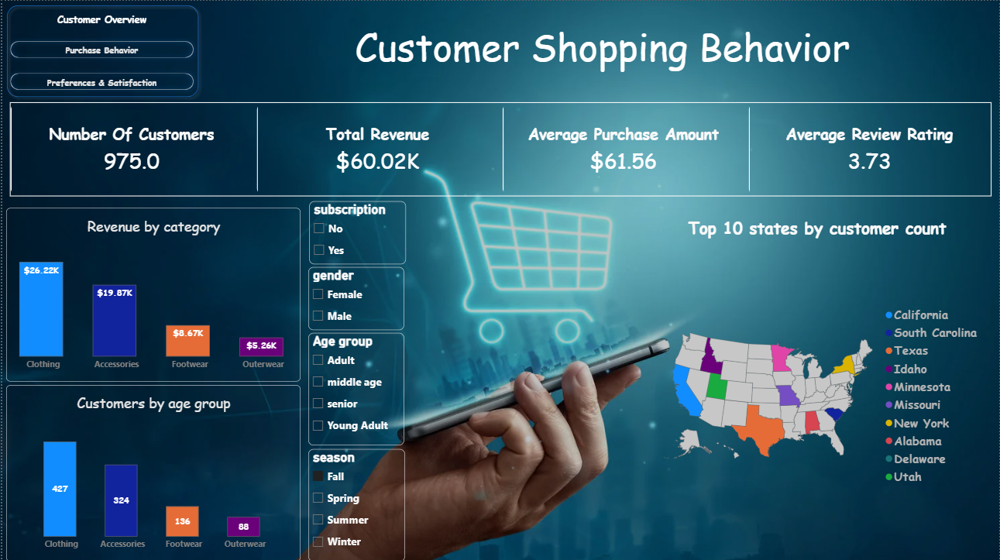
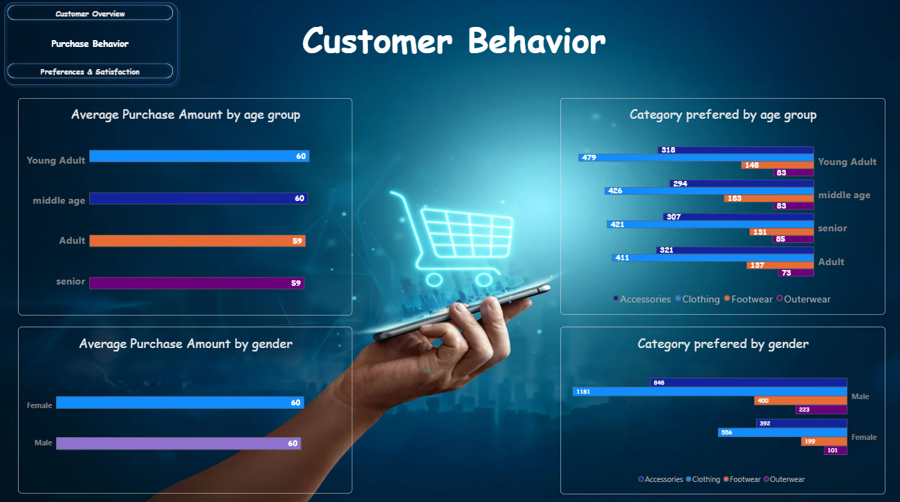
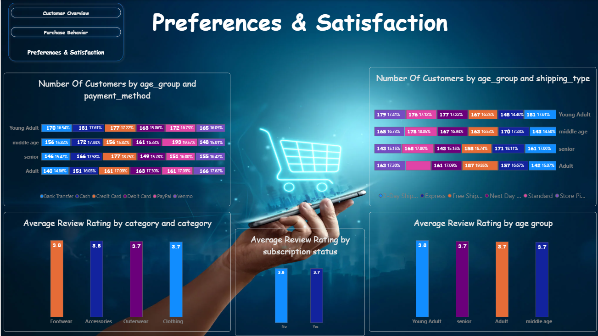

# Customer Shopping Behavior Analysis

A complete data analytics project: Python cleaning and EDA, SQL business queries, an interactive Power BI dashboard, a written report, and a presentation.

## Overview

A retail company wants to know what drives customer purchases, loyalty and satisfaction. This project analyzes 3,900 customer records to find trends and give data-backed recommendations on marketing, discounts, subscriptions and product strategy.

**Business question:** How can the company use shopping data to improve customer engagement and optimize marketing and product strategy?

## Dataset

- **Size:** 3,900 rows, 18 columns (one row per customer)
- **Demographics:** age, gender, location, subscription status
- **Purchase details:** item, category, purchase amount, season, size, color
- **Behavior:** discount applied, previous purchases, purchase frequency, review rating, shipping type, payment method
- **Data quality:** 37 missing review ratings (0.9%), no duplicates

## Tools

| Purpose | Tools |
|---|---|
| Data cleaning and EDA | Python (pandas, SQLAlchemy), Jupyter Notebook |
| Database and analysis | MySQL (queries also work on PostgreSQL and SQL Server with minor syntax changes) |
| Dashboard | Power BI (DAX) |
| Presentation | Gamma |
| Version control | Git and GitHub |

## Steps

1. **Load and explore (Python):** imported the CSV and checked structure, data types and summary statistics.
2. **Clean the data:** filled missing review ratings with the category median, standardized column names, and removed a duplicate column (`promo_code_used`).
3. **Create features:** `age_group` (four age bands) and `purchase_frequency_days`.
4. **Load into the database:** saved the cleaned data into MySQL.
5. **Run SQL analysis:** 10 business queries on revenue by gender and age group, discount behavior, subscriptions, customer segments, top products and ratings.
6. **Build the dashboard (Power BI):** three interactive pages with KPIs, slicers and charts.
7. **Write the report:** summarized findings, limitations and recommendations in a PDF.
8. **Create the presentation (Gamma):** turned the key insights into a short stakeholder deck.

## Dashboard

| Customer Overview | Purchase Behavior | Preferences & Satisfaction |
|---|---|---|
|  |  |  |

## Results

- **Spend is nearly the same across segments** (about $60 average). Gender, subscription, discounts, payment method, shipping and age group show no significant difference.
- **Season is the one real driver:** Fall averages $61.56 vs $58.41 in Summer.
- **Men generate 2x the revenue** because they are 68% of customers, not because they spend more.
- **Subscribers do not spend more** ($59.49 vs $59.87), and every subscriber gets a discount, which may reduce margin.
- **Clothing and Accessories are 77% of revenue.**

**Recommendations:** grow the female customer base, re-evaluate the subscription program, test targeted discounts, plan promotions around season, and build a tiered loyalty program.

**Full documents:**
- Report: [`reports/Customer_Shopping_Behavior_Analysis_Report.pdf`](reports/Customer_Shopping_Behavior_Analysis_Report.pdf)
- Presentation: *add your Gamma link here*

## How to Run

1. **Clone the repo and install packages**
   ```bash
   git clone https://github.com/<your-username>/customer-shopping-behavior-analysis.git
   cd customer-shopping-behavior-analysis
   pip install pandas sqlalchemy pymysql python-dotenv jupyter
   ```
2. **Add your database details.** Copy `.env.example` to `.env` and fill it in (never commit this file).
   ```
   DB_USER=your_user
   DB_PASSWORD=your_password
   DB_HOST=localhost
   DB_PORT=3306
   DB_NAME=customer_behavior
   ```
3. **Run the notebook** in `notebooks/` to clean the data and load it into the database.
4. **Run the queries** in `sql/` against the `customer` table.
5. **Open the dashboard** in `dashboard/` using Power BI Desktop.

## Project Structure

```
├── data/          # raw dataset
├── notebooks/     # Python cleaning and EDA
├── sql/           # SQL queries
├── dashboard/     # Power BI file
├── images/        # dashboard screenshots
├── reports/       # PDF report
└── README.md
```

## Limitations

Each customer has one purchase, so revenue is not lifetime value. There is no date or online/offline column. Many fields are evenly distributed, which suggests a synthetic dataset.

## Author

**Bhanu Pratap** | Data Analyst | Noida
[LinkedIn](https://linkedin.com/in/your-profile) | [GitHub](https://github.com/your-username)
